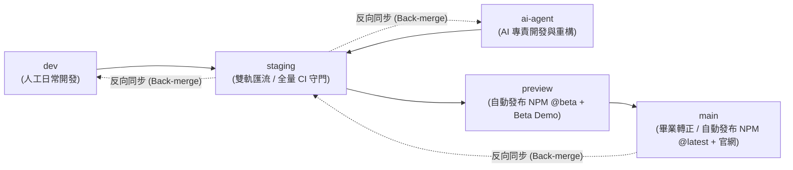

# 🛠️ AI Avatar Bot 協作、分支治理與發布標準作業程序 (CONTRIBUTING & Release SOP)

本文件規範 `ai-avatar-bot` Monorepo 的**五階分支策略**、**套件與 Vercel Demo 對照矩陣**、**跨平台版本號防呆機制**，以及從 `@beta` 晉升至 `@latest` 正式版的**手動畢業與反向同步（Back-merge）SOP**。

---

## 📦 一、Monorepo 套件與 Vercel Demo 對照矩陣

> [!NOTE]
> **Git 倉庫根目錄說明**：在 GitHub 遠端倉庫 (`archer102125220/ai-avatar-bot`) 中，本目錄（本地工作區 `package/`）即為 **Git Repository Root**。因此 GitHub Actions 路徑過濾與 Vercel 的 `Root Directory` 均以倉庫根目錄相對路徑（如 `typescript`、`iframe`）為準。

| 倉庫目錄路徑 | NPM 套件名稱 | GitHub Actions CI/CD | Vercel 專案名稱 | Vercel 網域 (正式 / 預覽) | 定位說明 |
| :--- | :---: | :---: | :--- | :--- | :--- |
| [`typescript`](./typescript) | **`@ai-avatar-bot/sdk`** | ✅ 全量 CI + 自動 CD | `ai-avatar-bot-sdk-demo` | `https://ai-avatar-bot-sdk-demo.vercel.app`<br>`https://beta.ai-avatar-bot-sdk-demo.vercel.app` | 原生 TypeScript 旗艦核心 SDK（含完整 UI Widget、2D/3D 雙渲染、語音與大腦引擎） |
| [`iframe`](./iframe) | ❌ **不發布** | ❌ **不跑 CI/CD** | `ai-avatar-bot-iframe-demo` | `https://ai-avatar-bot-iframe-demo.vercel.app` | **經典純 Demo 部署**：展示 `embed.js` 一行腳本嵌入與 Serverless TTS，不發布 NPM 套件 |
| [`vue`](./vue) | **`@ai-avatar-bot/vue`** | 🚧 進行中 | `ai-avatar-bot-vue-demo` | `https://ai-avatar-bot-vue-demo.vercel.app` | Vue 3 官方封裝元件庫 |
| [`react`](./react) | **`@ai-avatar-bot/react`** | 🚧 進行中 | `ai-avatar-bot-react-demo` | `https://ai-avatar-bot-react-demo.vercel.app` | React 18 / 19 官方封裝元件庫 |

### Vercel 專案設定基準（含路徑智慧過濾）

1. **`ai-avatar-bot-sdk-demo`**：
   * **Root Directory**：`typescript`
   * **Build Command**：`yarn build:demo`
   * **Output Directory**：`dist-demo`
   * **Ignored Build Step**（建議設定於 *Project Settings ➔ Git*）：`git diff --quiet HEAD^ HEAD ./`（僅當 `typescript/` 有變動時才觸發 Vercel 構建）
2. **`ai-avatar-bot-iframe-demo`**：
   * **Root Directory**：`iframe`
   * **設定檔**：由 [`iframe/vercel.json`](./iframe/vercel.json) 自動託管靜態 HTML 與 `/api/tts` Serverless Function
   * **Ignored Build Step**：`git diff --quiet HEAD^ HEAD ./`

---

## 🌿 二、五階分支體系與 CI 額度精算規範

為兼顧「人工開發 / AI 協作雙軌並行」與「節省 90% 以上 GitHub Actions 額度」，專案採用五階分支匯流體系：



| 分支名稱 | 核心定位 | 遠端 GitHub Actions CI | 自動發布行為 (CD & Vercel) |
| :--- | :--- | :---: | :--- |
| **`dev`** | 純手動人工功能開發與試驗 | ❌ **不觸發**（本地自測節省額度） | ❌ 無 |
| **`ai-agent`** | AI 代理專責代碼生成、重構與補測試 | ❌ **不觸發**（本地自測節省額度） | ❌ 無 |
| **`staging`** | 人工與 AI 雙軌匯流整合檢查站 | ✅ **全量 CI 守門**（[`ci.yml`](./.github/workflows/ci.yml)） | ❌ **不發布 NPM**（純品質驗證） |
| **`preview`** | 公開預覽版基地（Public Beta） | ✅ 全量 CI + 路徑過濾 CD | ✅ 若 `typescript/**` 有改動 ➔ 自動發布 **NPM `@beta`** + GitHub Pre-release + Vercel Beta 站 |
| **`main`** | 官方正式穩定版基地（Stable GA） | ✅ 全量 CI + 路徑過濾 CD | ✅ 若 `typescript/**` 有改動 ➔ 自動發布 **NPM `@latest`** + GitHub Release + Vercel 正式官網 |

### 開發者在 `dev` / `ai-agent` 合併至 `staging` 前的本地必跑檢查

```bash
yarn lint:ts
yarn typecheck:ts
yarn test:ts
yarn build:ts
yarn build:ts:demo
```

---

## 🛡️ 三、跨平台本地版本號防呆機制 (`pre-push` Guard)

專案內建純 Node.js 跨平台驗證腳本 [`scripts/verify-branch-version.mjs`](./scripts/verify-branch-version.mjs) 並綁定於 Husky [`.husky/pre-push`](./.husky/pre-push)（相容 macOS 與 Windows）：

* **規則 A（推送至 `preview` 分支）**：
  * [`typescript/package.json`](./typescript/package.json) 的 `version` **必須包含 `-beta.`**（例如 `1.0.0-beta.0`、`1.0.0-beta.1`），否則本地直接攔截退出（Exit Code `1`）。
* **規則 B（推送至 `main` 分支）**：
  * `version` **嚴禁包含 `-beta` 等預覽後綴**，且按 SemVer 2.0.0 優先序必須**嚴格大於 (`>`) 目前倉庫最新的 SemVer Git Tag**（注意：`1.0.0 > 1.0.0-beta.x` 合規放行；但若已有 `v1.0.0` Tag 則再次推送 `1.0.0` 會被攔截）。
* **雲端雙重防線**：[`ci.yml`](./.github/workflows/ci.yml) 與 [`release-sdk.yml`](./.github/workflows/release-sdk.yml) 第一步亦會執行同一支腳本，杜絕繞過 Hook 的風險。

---

## 🎓 四、從 `@beta` 畢業轉正至 `@latest` 的 4 步手動 SOP

當 `preview` 分支上的預覽版（例如 `1.0.0-beta.3`）完成社群驗證與架構解耦、準備晉升為正式版 `1.0.0` 時，請依序執行以下 **4 步畢業 SOP**：

### Step 1：從 `preview` 切出畢業發布分支（或直接在準備合併至 `main` 的分支操作）

```bash
git checkout preview
git pull origin preview
git checkout -b release/v1.0.0
```

### Step 2：拔除 `-beta` 後綴並切換預設發布標籤

於 `typescript/` 目錄執行 `npm version`（加上 `--no-git-tag-version`，因為正式 Git Tag 統一由 GitHub Actions `github-actions[bot]` 在發布成功後自動建立）：

```bash
cd typescript
npm version 1.0.0 --no-git-tag-version
cd ..
```

> 💡 同時可視需求將 `typescript/package.json` 中的 `"publishConfig.tag"` 由 `"beta"` 更新為 `"latest"`（註：[`release-sdk.yml`](./.github/workflows/release-sdk.yml) 在 `main` 分支執行時亦會透過 `--tag latest` 強制覆寫為正式通道）。

### Step 3：提交版號變更並發起 `Release PR` 至 `main`

```bash
git add typescript/package.json
git commit -m "chore(release): graduate @ai-avatar-bot/sdk to v1.0.0"
git push -u origin release/v1.0.0
```

於 GitHub 開立 Pull Request：**`release/v1.0.0` ➔ `main`**，等待 `CI Gatekeeper`（含 `verify-branch-version.mjs` 正式版規則檢查與全量測試）全綠通過。

### Step 4：合併進入 `main` 觸發全自動上架

核准並 Merge PR 至 `main` 後：
1. [`release-sdk.yml`](./.github/workflows/release-sdk.yml) 自動以 `npm publish --tag latest --access public` 上架正式版。
2. `github-actions[bot]` 自動推送 `v1.0.0` Git Tag 並建立正式版 GitHub Release。
3. Vercel 自動更新正式展示站 `https://ai-avatar-bot-sdk-demo.vercel.app`。

---

## 🔄 五、正式發布後的反向同步規範 (Back-merge SOP)

每次完成 `main` 正式版發布後，**必須立即執行反向同步（Back-merge）**，確保下游開發分支擁有最新的正式版號基準與歷史紀錄，避免日後合併衝突或版號倒退：

```bash
# 1. 將 main 同步回 staging 與 preview
git checkout staging
git pull origin staging
git merge origin/main
git push origin staging

# 2. 將 staging 同步回日常開發雙軌分支 (dev 與 ai-agent)
git checkout dev
git merge staging
git push origin dev

git checkout ai-agent
git merge staging
git push origin ai-agent
```

> **開啟下一輪 Beta 週期提醒**：當下一階段新功能準備再次推入 `preview` 分支前，請先在開發分支執行 `cd typescript && npm version 1.1.0-beta.0 --no-git-tag-version`（或 `1.0.1-beta.0`），以符合 `preview` 分支的 `-beta.` 防呆守門規範。

