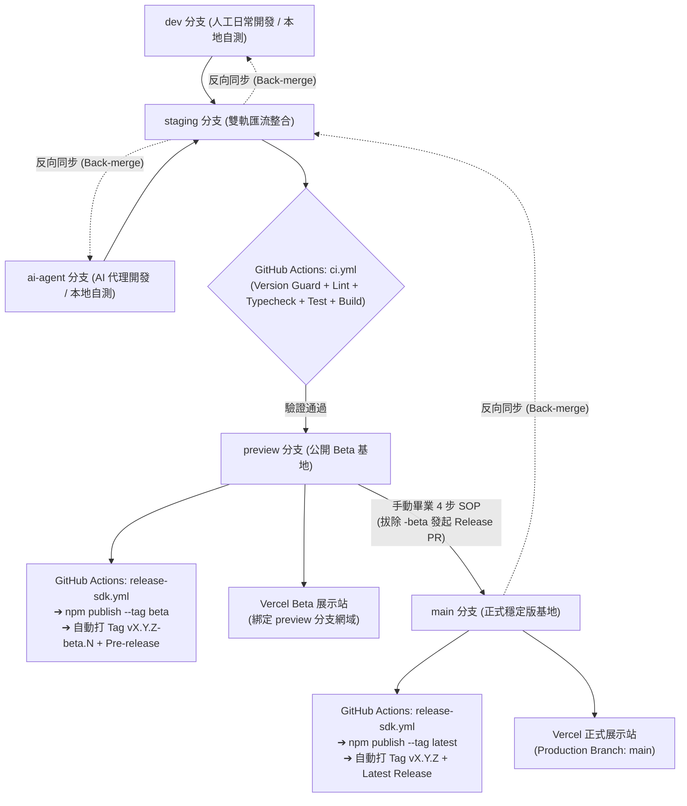

# 📘 NPM 套件自動化發布與 Vercel 多專案部署實戰教學手冊
*(Universal Playbook: Scoped NPM Release + 5-Stage Branching + GitHub Actions CI/CD + Vercel Monorepo Demos)*

> [!NOTE]
> **手冊定位**：本文件將 `ai-avatar-bot`（`@ai-avatar-bot/sdk`）從零完成 **NPM 組織套件首發**、**五階分支治理**、**跨平台本地防呆**、**GitHub Actions 智慧路徑過濾發布** 到 **Vercel 雙專案線上展示站串接** 的完整實作與除錯經驗，提煉為一份**跨專案通用的標準教學手冊**。日後在任何新專案（單一倉庫或 Monorepo）皆可直接對照本手冊與本倉庫設定檔快速複製落地。

---

## 📑 目錄

1. [架構全景與本專案對照索引](#-一架構全景與本專案對照索引)
2. [階段一：NPM 組織建立、套件配置與金鑰認證（避坑指南）](#-二階段一npm-組織建立套件配置與金鑰認證)
3. [階段二：跨平台分支與 SemVer 版本防呆機制（Husky + Node.js）](#-三階段二跨平台分支與-semver-版本防呆機制)
4. [階段三：分離「NPM 函式庫打包」與「Vercel 線上 Demo 打包」](#-四階段三分離npm-函式庫打包與vercel-線上-demo-打包)
5. [階段四：五階分支體系與 CI 額度精算策略](#-五階段四五階分支體系與-ci-額度精算策略)
6. [階段五：GitHub Actions 雙工作流（CI 守門 + 路徑過濾自動 CD）](#-六階段五github-actions-雙工作流ci-守門--路徑過濾自動-cd)
7. [階段六：Vercel 多專案連接、網域綁定與 CLI 自動化檢修](#-七階段六vercel-多專案連接網域綁定與-cli-自動化檢修)
8. [階段七：日常維運 SOP（Beta 迭代、正式版畢業 4 步曲、反向同步）](#-八階段七日常維運-sop)
9. [附錄 A：11 個真實踩坑與秒解速查表（Troubleshooting）](#-附錄-a11-個真實踩坑與秒解速查表)
10. [附錄 B：新專案一鍵套用之 AI 啟動 Prompt 範本](#-附錄-b新專案一鍵套用之-ai-啟動-prompt-範本)

---

## 🧭 一、架構全景與本專案對照索引

### 1.1 這套架構解決了哪些痛點？

* **支援人工與 AI 雙軌開發且不燒乾 CI 額度**：日常在 `dev`（人工）與 `ai-agent`（AI）高頻提交時**不觸發遠端 GitHub Actions**，匯流至 `staging` 才集中跑全量 CI 守門，節省 90% 以上免費分鐘數。
* **預覽版（`@beta`）與正式版（`@latest`）雙軌隔離**：推入 `preview` 自動發布 NPM `@beta` 與 GitHub Pre-release 並更新 Vercel Beta 試玩站；推入 `main` 自動發布 NPM `@latest` 與正式版官網。
* **Monorepo 智慧路徑過濾（Path Filtering）**：只有目標套件目錄（如 `typescript/**`）有變更才觸發發布工作流與對應的 Vercel Demo 構建，修改其他子專案或根目錄文檔互不干擾。
* **Mac / Windows 雙平台防呆**：以純 Node.js 腳本取代 `sed`/`awk`/Bash 差異，在本地 `git push` 瞬間攔截「忘記拔 `-beta` 就推上 `main`」或「正式版推入 `preview`」的人為失誤。

### 1.2 全域研發與發布管線圖



### 1.3 本倉庫實戰檔案對照索引

在新專案實作時，可直接點開以下檔案作為生產級範本參考：

| 功能模組 | 本專案對應檔案路徑 | 用途說明 |
| :--- | :--- | :--- |
| **Monorepo 根配置** | [`../package.json`](../package.json) | 宣告 `workspaces`、`packageManager` (`yarn@4.17.0`)、Husky `prepare` 與統一構建/測試指令 |
| **SDK 發布配置** | [`../typescript/package.json`](../typescript/package.json) | Scoped 名稱 `@ai-avatar-bot/sdk`、`publishConfig`、`exports`、`files`、`prepublishOnly` |
| **Demo 獨立打包配置** | [`../typescript/vite.demo.config.ts`](../typescript/vite.demo.config.ts) | 將 `index.html` 與靜態資產獨立打包至 `dist-demo/` 供 Vercel 部署 |
| **純靜態/Serverless 配置** | [`../iframe/vercel.json`](../iframe/vercel.json) | 不發 NPM、純做 Vercel Demo 與 Serverless API 的輕量配置範例 |
| **跨平台版本守門腳本** | [`../scripts/verify-branch-version.mjs`](../scripts/verify-branch-version.mjs) | 同時支援本地 Husky `pre-push` 與雲端 GitHub Actions 的 SemVer 分支防呆腳本 |
| **Husky Pre-push Hook** | [`../.husky/pre-push`](../.husky/pre-push) | 內建 `fnm` / `nvm` / Homebrew PATH 偵測保護，確保 GUI Git 工具也能找到 `node` |
| **CI 集中守門工作流** | [`../.github/workflows/ci.yml`](../.github/workflows/ci.yml) | 僅監聽 `staging` / `preview` / `main` 的 Push 與 PR，負責全量測試把關 |
| **CD 自動發布工作流** | [`../.github/workflows/release-sdk.yml`](../.github/workflows/release-sdk.yml) | 含 `paths` 過濾、防重複 Tag 檢查、自動區分 `beta`/`latest` 發布與建立 GitHub Release |
| **團隊分支與畢業 SOP** | [`../CONTRIBUTING.md`](../CONTRIBUTING.md) | 供團隊成員查閱的日常協作、畢業轉正與反向同步規範 |

---

## 🔑 二、階段一：NPM 組織建立、套件配置與金鑰認證

### Step 1.1：註冊 NPM Organization（建議採用 `@scope/pkg` 命名）

1. 登入 [npmjs.com](https://www.npmjs.com/) ➔ 點擊右上角頭像 ➔ **Add Organization**。
2. 輸入組織名稱（例如 `ai-avatar-bot`，對應 Scope 為 `@ai-avatar-bot`），選擇 **Unlimited public packages (Free)** 免費建立。
3. **為什麼推薦 Scoped Package？**
   * 全域單字極易撞名或觸發 NPM 相似名稱風控攔截；掛在 `@your-org/` 底下可自由命名 `@your-org/sdk`、`@your-org/vue`、`@your-org/react`，形成一致的品牌矩陣。

### Step 1.2：配置目標套件的 `package.json`

在要發布的子專案（或單一倉庫根目錄）`package.json` 設定以下關鍵欄位：

```json
{
  "name": "@your-org/sdk",
  "version": "1.0.0-beta.0",
  "publishConfig": {
    "access": "public",
    "tag": "beta"
  },
  "files": [
    "dist",
    "avatar-skin"
  ],
  "main": "./dist/index.cjs",
  "module": "./dist/index.js",
  "types": "./dist/index.d.ts",
  "repository": {
    "type": "git",
    "url": "git+https://github.com/<github-owner>/<repo-name>.git",
    "directory": "typescript"
  },
  "scripts": {
    "build": "tsc && vite build",
    "build:demo": "vite build --config vite.demo.config.ts",
    "test:unit": "vitest run",
    "test:typecheck": "tsc --noEmit",
    "prepublishOnly": "yarn test:typecheck && yarn test:unit && yarn build"
  }
}
```

> [!IMPORTANT]
> **Scoped 套件公開發布必填 `"access": "public"`**：NPM 預設將 `@scope/pkg` 視為私有付費套件（會報 `402 Payment Required`）。在 `publishConfig` 寫明 `"access": "public"` 且發布指令加上 `--access public` 即可免費公開發布；同時加上 `"tag": "beta"` 可防止手動誤敲 `npm publish` 時不小心覆蓋正式版 `latest` 通道。

### Step 1.3：產生 NPM Granular Access Token 並存入 GitHub Secrets

NPM 官方已全面淘汰舊版 Classic / Automation Token，請改用 **Granular Access Token (GAT)**：

1. 前往 [npmjs.com](https://www.npmjs.com/) ➔ 右上角頭像 ➔ **Access Tokens** ➔ **Generate New Token** ➔ **Granular Access Token**。
2. 依序填寫以下欄位：
   * **Token name**：`github-actions-release`
   * **Expiration**：`90 days`（或依組織政策設定）
   * **Packages and scopes**：選擇 **Only select packages and scopes** ➔ 選取 `@your-org` 組織，權限設為 **Read and write**。
   * **Bypass two-factor authentication (2FA)**：**✅ 務必勾選此項！**
3. 複製產生的 `npm_...` 金鑰。
4. 前往 GitHub 倉庫 ➔ **Settings** ➔ **Secrets and variables** ➔ **Actions** ➔ **New repository secret**：
   * **Name**：`NPM_TOKEN`
   * **Secret**：貼上剛才複製的 `npm_...` 金鑰。

> [!CAUTION]
> **頭號失敗原因（`npm error code EOTP`）**：若建立 Granular Access Token 時**漏勾 `Bypass two-factor authentication (2FA)`**，GitHub Actions 執行到 `npm publish` 時會要求輸入手機驗證器動態密碼（OTP），在無頭伺服器上會直接以 `npm error code EOTP` 中斷失敗！

### Step 1.4：（首發成功後可選）升級為 NPM Trusted Publishing (OIDC 免密鑰發布)

當首個版本（例如 `1.0.0-beta.0`）已成功上架到 NPM 後，套件頁面才會出現設定入口：
1. 前往 `https://www.npmjs.com/package/@your-org/sdk/access`（套件 **Settings** 頁面）。
2. 在 **Trusted Publisher** 區塊選擇 **GitHub Actions**，綁定：
   * **Organization or user**：`<github-owner>`
   * **Repository**：`<repo-name>`
   * **Workflow filename**：`release-sdk.yml`
3. 確認 `.github/workflows/release-sdk.yml` 已宣告 `permissions: id-token: write`（本手冊範本已預設內建），且 Node 內建 npm 版本 `>= 11.5.1`，即可移除 `NPM_TOKEN` 達成永久免維護、無過期風險的無密鑰發布。

---

## 🛡️ 三、階段二：跨平台分支與 SemVer 版本防呆機制

為了避免開發者在 Mac 或 Windows 上手滑「帶著 `-beta` 推上 `main`」或「把正式版推到 `preview`」，我們使用純 Node.js 腳本搭配 Husky `pre-push` Hook 建立雙向防線。

### Step 2.1：安裝 Husky 並建立 `pre-push` Hook

1. 於 Git 倉庫根目錄安裝 Husky：
   ```bash
   yarn add -D -W husky
   ```
2. 在根目錄 `package.json` 確認包含 `"prepare": "husky"` 與 `"verify:version": "node scripts/verify-branch-version.mjs"`，執行一次 `yarn prepare` 產生 `.husky/` 目錄。
3. 建立 `.husky/pre-push`（完整範本見 [`../.husky/pre-push`](../.husky/pre-push)）：

```sh
if ! command -v node >/dev/null 2>&1; then
  export PATH="/opt/homebrew/bin:/usr/local/bin:$HOME/.volta/bin:$HOME/.local/share/mise/shims:$PATH"
  if command -v fnm >/dev/null 2>&1; then
    eval "$(fnm env)"
  elif [ -s "$HOME/.nvm/nvm.sh" ]; then
    . "$HOME/.nvm/nvm.sh"
  fi
fi

node scripts/verify-branch-version.mjs
```

> [!TIP]
> **為什麼要在 `.husky/pre-push` 前面加那段 `PATH` 與 `fnm`/`nvm` 偵測？**
> 在 macOS 上使用 VS Code 內建 Git 面板、Sourcetree、GitKraken 或 AI 代理的非互動式 Shell 執行 `git push` 時，系統不會載入 `~/.zshrc`，常出現 `command not found: node`。加上這段 POSIX 相容保護可確保所有環境一致生效。

### Step 2.2：複製並調整 `scripts/verify-branch-version.mjs`

直接複製本倉庫的 [`../scripts/verify-branch-version.mjs`](../scripts/verify-branch-version.mjs) 至新專案的 `scripts/verify-branch-version.mjs`，僅需修改檔案開頭第 24 行的目標套件路徑與預設名稱：

```javascript
// 若為 Monorepo 子目錄（如 packages/sdk/package.json）：
const sdkPkgPath = path.join(repoRoot, 'typescript', 'package.json');
// 若為單一倉庫（Single Repo），直接改為：
// const sdkPkgPath = path.join(repoRoot, 'package.json');
```

#### 腳本內建的三大環境自動偵測與兩大鐵律
* **自動環境偵測**：
  1. CLI 測試參數：`node scripts/verify-branch-version.mjs --branch main`
  2. GitHub Actions：PR 自動讀 `GITHUB_BASE_REF`、Push 自動讀 `GITHUB_REF_NAME`
  3. Git `pre-push`：自動解析 Git 傳入 `stdin` 的 `<local_ref> <local_oid> <remote_ref> <remote_oid>`（刪除遠端分支時自動放行）
* **規則 A（目標 `preview`）**：版本號必須包含 `-beta.`（如 `1.0.0-beta.0`），否則攔截退出。
* **規則 B（目標 `main`）**：版本號嚴禁含任何預覽後綴，且按 SemVer 2.0.0 比較必須**嚴格大於 (`>`) 倉庫最新 SemVer Git Tag**（例如 `1.0.0 > 1.0.0-beta.2` 合規放行；但若已存在 `v1.0.0` Tag 則禁止重複推送 `1.0.0`）。

### Step 2.3：在本地用 `--dry-run` 驗證攔截效果（不會實際推送）

```bash
# 測試當版本為 1.0.0-beta.0 時：
git push origin HEAD:preview --dry-run   # ✔ 預期通過
git push origin HEAD:main --dry-run      # ✖ 預期遭規則 B 紅字攔截！
```

---

## 📦 四、階段三：分離「NPM 函式庫打包」與「Vercel 線上 Demo 打包」

若你的套件同時需要「發布給別人 `npm install`」與「自己部署一個線上互動試玩站到 Vercel」，**請務必將兩者的 Vite 設定檔分開**！

* **`vite.config.ts`（Library 模式，輸出至 `dist/`）**：
  * 設定 `build.lib`，並將 `vue` / `react` / `three` / `pixi.js` 等 Peer Dependencies 設為 `external`，避免把巨型依賴塞進消費者的專案。
* **`vite.demo.config.ts`（SPA 展示站模式，輸出至 `dist-demo/`，範本見 [`../typescript/vite.demo.config.ts`](../typescript/vite.demo.config.ts)）**：
  * 以目錄下的 `index.html` 作為單頁應用入口，將所有執行期依賴與靜態資源完整打包進 `dist-demo/`，讓瀏覽器打開網址即可直接互動。

```typescript
import { defineConfig } from 'vite';
import { resolve } from 'path';

export default defineConfig({
  resolve: {
    alias: {
      '@': resolve(import.meta.dirname, '.')
    }
  },
  publicDir: 'public',
  build: {
    target: 'es2022', // 若 index.html 有使用 Top-level await，請設為 es2022 以上
    outDir: 'dist-demo',
    emptyOutDir: true,
    copyPublicDir: true
  }
});
```

1. 在子專案 `package.json` 加入 `"build:demo": "vite build --config vite.demo.config.ts"`。
2. 在根目錄 `.gitignore` 加入 `dist-demo`，避免將本地構建產物誤提交進 Git。
3. 本地執行 `yarn build:demo` 確認 `dist-demo/index.html` 與靜態資產皆完整產出。

---

## 🌿 五、階段四：五階分支體系與 CI 額度精算策略

在新專案準備上線前，依序建立五階分支基底並推送至遠端 `origin`：

| 分支名稱 | 職責定位 | 遠端 CI | 自動發布 NPM | 對應 Vercel 環境 |
| :--- | :--- | :---: | :---: | :--- |
| **`dev`** | 人工日常功能開發 | ❌ 關閉 | ❌ 無 | 無（或一般分支預覽） |
| **`ai-agent`** | AI 代理重構、補測試與開發 | ❌ 關閉 | ❌ 無 | 無 |
| **`staging`** | 雙軌匯流整合測試站 | ✅ **全量守門** | ❌ **不發布** | 一般分支預覽 |
| **`preview`** | 公開 Beta 預覽基地 | ✅ 全量守門 | ✅ **`@beta` 通道** | 綁定 `<project>-beta.vercel.app` |
| **`main`** | 官方正式穩定版基地 | ✅ 全量守門 | ✅ **`@latest` 通道** | 綁定 `<project>.vercel.app` (Production) |

### 初始化分支指令

```bash
# 假設目前已在開發完成的穩定分支（如 dev 或 ai-agent）
git checkout -b staging
git push -u origin staging

git checkout -b preview
git push -u origin preview
```

---

## ⚙️ 六、階段五：GitHub Actions 雙工作流（CI 守門 + 路徑過濾自動 CD）

於 **Git 倉庫根目錄** 建立 `.github/workflows/ci.yml` 與 `.github/workflows/release-sdk.yml`。

### 6.1 品質守門工作流：`.github/workflows/ci.yml`

完整實戰檔案請參考 [`../.github/workflows/ci.yml`](../.github/workflows/ci.yml)。核心設計要點：
1. **`on.push.branches` 與 `on.pull_request.branches` 僅列 `['staging', 'preview', 'main']`**：徹底排除 `dev` 與 `ai-agent` 的高頻草稿推送。
2. **`fetch-depth: 0`**：完整拉取 Git Tags，讓 `verify-branch-version.mjs` 在 `main` 分支能精準比對最新 SemVer Tag。
3. **Yarn 4 Berry 快取**：同時快取 `.yarn/cache` 與 `~/.cache/node/corepack`，並以 `yarn install --immutable` 鎖定依賴一致性。

### 6.2 自動發布工作流：`.github/workflows/release-sdk.yml`

完整實戰檔案請參考 [`../.github/workflows/release-sdk.yml`](../.github/workflows/release-sdk.yml)。以下為跨專案移植時最關鍵的五個設計細節：

```yaml
on:
  push:
    branches:
      - preview
      - main
    paths:
      - 'typescript/**' # 👈 換成你的套件目錄；若為單一倉庫可移除 paths 限制
  workflow_dispatch:    # 👈 必留！方便新建分支或更新 Secret 後手動一鍵觸發
```

1. **必要的 `permissions` 宣告**：
   ```yaml
   permissions:
     contents: write # 允許 github-actions[bot] 回寫 Git Tag 與建立 GitHub Release
     id-token: write # 預留未來無縫啟用 NPM Trusted Publishing (OIDC) 與 provenance
   ```
2. **防重複發布保護 (`already_tagged`)**：
   先讀取 `package.json` 的 `version`，用 `git rev-parse "refs/tags/v${VERSION}"` 檢查該版號 Tag 是否已存在；若已存在則自動跳過後續 `npm publish`，避免合併無升版修補時報錯。
3. **設定 NPM Registry 後務必重新 `corepack enable`**：
   當呼叫 `actions/setup-node@v4` 並帶入 `registry-url: 'https://registry.npmjs.org'` 產生 `.npmrc` 時，Node 環境墊片可能被重置；若你的 `prepublishOnly` 腳本內含 `yarn ...` 指令，**請務必在 `setup-node` 下一步補上 `run: corepack enable`**！
4. **自動分流 `beta` 與 `latest`**：
   * `GITHUB_REF_NAME == 'preview'` ➔ `npm publish --tag beta --access public` + `gh release create --prerelease`
   * `GITHUB_REF_NAME == 'main'` ➔ `npm publish --tag latest --access public` + `gh release create --latest`

---

## 🌐 七、階段六：Vercel 多專案連接、網域綁定與 CLI 自動化檢修

在 Monorepo 架構下，同一個 GitHub 倉庫可以同時連接**多個獨立的 Vercel 專案**（例如一個給 TypeScript SDK Demo、一個給 Iframe Demo、一個給 Vue Demo）。

> [!WARNING]
> **設定路徑前，先確認你的 `.git` 資料夾在哪一層！**
> 以本專案為例，IDE 工作區外層有 `origin/` 與 `package/`，但真正的 `.git` 位於 `package/` 內。因此推上 GitHub 後，遠端倉庫根目錄底下的資料夾名稱是 `typescript` 與 `iframe`（**不是** `package/typescript`）。設定 Vercel 的 `Root Directory` 與 GitHub Actions `paths` 時，永遠以 **`.git` 所在目錄的相對路徑**為準！

### 7.1 Vercel 專案標準配置表（網頁後台或 CLI 皆適用）

| 設定欄位 | SDK Demo 專案範例 (`ai-avatar-bot-sdk-demo`) | 純靜態/Serverless 專案範例 (`ai-avatar-bot-iframe-demo`) |
| :--- | :--- | :--- |
| **GitHub Repository** | `<owner>/<repo>` | `<owner>/<repo>` |
| **Production Branch** | `main` | `main` |
| **Root Directory** | `typescript` | `iframe` |
| **Framework Preset** | `Vite` | `Other`（由目錄內 `vercel.json` 控制） |
| **Node.js Version** | **`24.x`**（或 `22.x`，切勿盲用預設超新版如 `26.x`） | **`24.x`** |
| **Build Command** | **`yarn build:demo`** | 留空（預設） |
| **Output Directory** | **`dist-demo`** | 留空（預設） |
| **Ignored Build Step** | **`git diff --quiet HEAD^ HEAD ./ ../shared`** *(若有跨目錄共用程式碼)* | **`git diff --quiet HEAD^ HEAD ./`** |
| **Environment Variables** | **`ENABLE_EXPERIMENTAL_COREPACK=1`** *(Yarn 4 必設！)* | 依專案需求設定 |
| **Production 網域** | `<project>.vercel.app`（綁定 `main`） | `<project>.vercel.app`（綁定 `main`） |
| **Beta 預覽網域** | **`<project>-beta.vercel.app`**（綁定 `preview` 分支） | 選配 |

### 7.2 透過 Vercel CLI + REST API 一鍵檢查與自動化修正（免翻網頁後台）

如果你在網頁後台建好專案後不確定設定是否正確，可以直接在本機透過 `npx vercel` CLI 進行精準體檢與自動修補：

#### 1. 登入並查看團隊與專案清單
```bash
npx vercel whoami --format json
npx vercel project ls --scope <your-team-slug> --format json
```

#### 2. 一次補齊 `Node 版本`、`Build Command`、`Output Directory` 與 `Ignored Build Step`
```bash
npx vercel api /v9/projects/<project-name> -X PATCH \
  --scope <your-team-slug> \
  --raw-field 'nodeVersion=24.x' \
  --raw-field 'buildCommand=yarn build:demo' \
  --raw-field 'outputDirectory=dist-demo' \
  --raw-field 'commandForIgnoringBuildStep=git diff --quiet HEAD^ HEAD ./' \
  --raw
```

#### 3. 為 Yarn 4 Monorepo 注入 `ENABLE_EXPERIMENTAL_COREPACK=1` 環境變數
```bash
npx vercel api "/v10/projects/<project-name>/env?upsert=true" -X POST \
  --scope <your-team-slug> \
  --input - --raw <<'EOF'
{"key":"ENABLE_EXPERIMENTAL_COREPACK","value":"1","type":"plain","target":["production","preview","development"]}
EOF
```

#### 4. 新增三層 Beta 網域並自動綁定至 `preview` 分支
```bash
npx vercel api /v10/projects/<project-name>/domains -X POST \
  --scope <your-team-slug> \
  --input - --raw <<'EOF'
{"name":"<project-name>-beta.vercel.app","gitBranch":"preview"}
EOF
```

> [!IMPORTANT]
> **為什麼不能綁 `beta.<project>.vercel.app`？**
> Vercel 官方免費提供的 `*.vercel.app` 萬用字元 SSL 憑證僅涵蓋**單層子網域**（三層結構 `<name>.vercel.app`）。若嘗試建立四層網域 `beta.<name>.vercel.app`，API 會回傳 `403 does not have access to "*.<name>.vercel.app" domains`。因此免費網域請一律採用連字號格式 **`<name>-beta.vercel.app`**；若你有綁定自己購買的網域（如 `example.com`），則可正常建立 `beta.example.com`。

#### 5. 指定 GitHub 分支（如 `preview`）立即觸發雲端構建並等待完成
```bash
# 先查詢專案的 GitHub repoId：
# npx vercel api /v9/projects/<project-name> --scope <your-team-slug> --raw | jq '.link.repoId'

npx vercel api "/v13/deployments?forceNew=1" -X POST \
  --scope <your-team-slug> \
  --input - --raw <<'EOF'
{
  "name": "<project-name>",
  "project": "<project-id>",
  "gitSource": {
    "type": "github",
    "repoId": 123456789,
    "ref": "preview"
  }
}
EOF

# 追蹤構建直到 Ready，或查看構建日誌：
npx vercel inspect <deployment-id> --scope <your-team-slug> --wait --timeout 3m
npx vercel inspect <deployment-id> --scope <your-team-slug> --logs
```

#### 6. 開放外部訪客免登入瀏覽 Beta 預覽站（Deployment Protection 設定）
Vercel 新專案預設開啟 **Vercel Authentication (`Standard Protection`)**，這會讓所有非 `main` 分支的部署（包含 `<project>-beta.vercel.app`）對未登入外部訪客顯示 Vercel 登入頁：
* **本機開發者免關保護快速測試**：執行 `npx vercel curl https://<project>-beta.vercel.app/`。
* **對外公開作為社群試玩站**：前往 Vercel 專案後台 **Settings ➔ Deployment Protection ➔ Vercel Authentication**，將保護切換為 **Disabled**（或透過 API 將 `ssoProtection` 設為 `null`）並儲存，外部訪客即可直接點開網址體驗。

### 7.3 Monorepo 共用 API 轉接為 Vercel Serverless Function 與公開環境防呆

本地開發時若在 `vite.config.ts` 透過自訂 Plugin（`configureServer`）攔截 `/api/*`，該伺服器中介層**不會**在靜態打包（`vite build` 輸出 `dist-demo/`）後自動生效。上線至 Vercel 時請依 API 性質分流處理：

1. **無狀態雲端可執行 API（如 `/api/tts` 語音合成）**：
   * 在子專案建立 `api/tts.ts` 單行轉發 Monorepo 共用實作：
     ```ts
     // typescript/api/tts.ts
     // ⚠️ 若 package.json 設有 "type": "module"，Node 24 原生 ESM 執行期強制要求明確寫出 .js 副檔名！
     export { default } from '../../shared/api/tts.js';
     ```
   * 只要 `package.json` 已設定 `"files": ["dist", ...]` 白名單，`api/` 目錄就只會服務 Vercel Demo，**絕不會混入 NPM 發布套件**（可用 `npm pack --dry-run` 驗證）。
   * 同步將 Vercel 的 **Ignored Build Step** 擴充為 `git diff --quiet HEAD^ HEAD ./ ../shared`，確保修改共用 API 時也會觸發重新部署。
2. **僅限本機硬體的本地代理 API（如 `/api/ollama` 連本機 `127.0.0.1:11434`）**：
   * 雲端容器沒有本機 Ollama，且現代瀏覽器對公開 HTTPS 網站主動探測 Loopback 位址設有嚴格權限提示。請在 Demo `index.html` 判斷是否為本機 Loopback，僅在本地開發開啟自動探活：
     ```js
     const currentHostname = window.location.hostname;
     const isLocalLoopback =
       currentHostname === 'localhost' ||
       currentHostname === '127.0.0.1' ||
       currentHostname === '[::1]';

     // 公開線上環境停用預設本地端點並改為手動探活，優先走純前端 WebGPU / 內建知識庫
     const aiProviderBaseUrl = isLocalLoopback === true ? `${window.location.origin}/api/ollama` : '';
     ```

---

## 🎓 八、階段七：日常維運 SOP

### 8.1 日常發布下一個 Beta 版本（例如 `1.0.0-beta.0` ➔ `1.0.0-beta.1`）

1. 在 `dev` 或 `ai-agent` 完成功能開發，本地跑完檢查（`lint` / `typecheck` / `test` / `build` / `build:demo`）。
2. 遞增 Beta 版號（**加上 `--no-git-tag-version`**，讓雲端 Action 統一打 Tag）：
   ```bash
   cd typescript
   npm version prerelease --preid=beta --no-git-tag-version
   # 版本號自動變為 1.0.0-beta.1
   cd ..
   git add typescript/package.json
   git commit -m "chore(sdk): bump version to 1.0.0-beta.1"
   ```
3. 合併至 `staging` 確認 `CI Gatekeeper` 全綠 ➔ 合併並推送至 `preview` ➔ 自動上架 `@your-org/sdk@1.0.0-beta.1` (`@beta`) 並更新 Vercel Beta 站！

### 8.2 從 `@beta` 畢業轉正至 `@latest` 正式版的 4 步曲

當 Beta 驗證穩定、準備正式發布 `1.0.0` 時：

1. **切出發布分支**：
   ```bash
   git checkout preview && git pull origin preview
   git checkout -b release/v1.0.0
   ```
2. **拔除 `-beta` 後綴**：
   ```bash
   cd typescript
   npm version 1.0.0 --no-git-tag-version
   cd ..
   ```
   *(可選：同步將 `package.json` 的 `publishConfig.tag` 改為 `"latest"`)*
3. **推送並發起 Release PR 至 `main`**：
   ```bash
   git add typescript/package.json
   git commit -m "chore(release): graduate @your-org/sdk to v1.0.0"
   git push -u origin release/v1.0.0
   ```
   於 GitHub 建立 PR **`release/v1.0.0` ➔ `main`**，等待 CI 全綠。
4. **合併進入 `main`**：
   Merge PR 後，GitHub Actions 自動發布 `@your-org/sdk@1.0.0` (`@latest`)、打上 `v1.0.0` Git Tag 與正式版 Release，且 Vercel 自動點亮正式站 `https://<project>.vercel.app`！

### 8.3 正式版發布後的反向同步（Back-merge SOP）

每次 `main` 發布完成後，**務必將 `main` 反向合併回下游分支**，避免分支歷史分岔或下次版號倒退：

```bash
git checkout staging && git pull origin staging && git merge origin/main && git push origin staging
git checkout preview && git pull origin preview && git merge origin/main
# 注意：preview 分支受 pre-push 規則 A 保護，若要推回 preview 請先開啟下一輪 beta 版號（如 1.1.0-beta.0）
git checkout dev && git merge staging && git push origin dev
git checkout ai-agent && git merge staging && git push origin ai-agent
```

---

## 🧯 附錄 A：12 個真實踩坑與秒解速查表

| # | 現象 / 報錯訊息 | 根本原因 | 秒解方案 |
| :-: | :--- | :--- | :--- |
| **1** | GitHub Actions `npm publish` 報 `npm error code EOTP` | NPM Granular Access Token 未開啟繞過 2FA | 重新產生 GAT 並勾選 **`Bypass two-factor authentication (2FA)`**，更新 GitHub Secret `NPM_TOKEN` 後重跑 Action |
| **2** | 剛發完套件立刻查 `npm view @org/pkg@beta` 顯示 `404` 或 `0.0.0-stage` | NPM 對新套件（尤其檔案較大時）採用非同步背景資安掃描 | 屬正常現象！等待約 1～3 分鐘再執行 `npm view @org/pkg --json` 即可看到正式版號與 `beta` tag |
| **3** | 本地測試腳本執行 `npm pack` 找不到 `@org/pkg-1.0.0.tgz` | Scoped 套件打包檔名會移除 `@` 並將 `/` 轉成 `-` | 檔名規則改用 `pkg.name.replace(/^@/, '').replace(/\//g, '-')`（即 `org-pkg-1.0.0.tgz`） |
| **4** | GUI Git 工具或 AI 終端機 `git push` 報 `node: command not found` | 非互動式 Shell 未載入 `~/.zshrc` 中的 `fnm` / `nvm` | 在 `.husky/pre-push` 開頭補上 Homebrew / `fnm` / `nvm` 環境載入判斷（見階段二範本） |
| **5** | GitHub Actions 在 `setup-node` 設完 `registry-url` 後跑 `yarn` 變回 1.x | 第二次呼叫 `actions/setup-node` 重置了執行環境墊片 | 在設定 Registry 的 `setup-node` 下一步補一行 `run: corepack enable` |
| **6** | 第一次 `git push -u origin preview` 推新分支，卻沒觸發 `release-sdk.yml` | 指向既有 Commit SHA 建立新分支時，Push 事件 `commits` 清單為空，`paths` 過濾不匹配 | 在目標子目錄做一筆提交推上去，或在 GitHub Actions 頁面點選 `Run workflow`（`workflow_dispatch`）手動觸發首發 |
| **7** | GitHub Actions 路徑過濾或 Vercel `Root Directory` 找不到資料夾 | 本地外層多包了一層非 Git 工作區資料夾（如 `workspace/package/.git`） | 執行 `git rev-parse --show-toplevel` 確認真正的 Git 根目錄，所有雲端路徑皆相對於該目錄填寫 |
| **8** | Vercel 構建在 `install` 階段報 `The engine "node" is incompatible... Got "26.x"` | Vercel 新建專案預設選到過新的 Node 版本，超出依賴套件 `engines.node` 範圍 | 將 Vercel 專案的 Node.js Version 明確鎖定為 `24.x` 或 `22.x` |
| **9** | Monorepo 子專案在 Vercel 構建時跑成 `yarn install v1.22.19` 而非 Yarn 4 | `Root Directory` 指向子目錄時，Vercel 預設未自動啟動根目錄的 Corepack | 在 Vercel 專案新增環境變數 **`ENABLE_EXPERIMENTAL_COREPACK=1`**（全環境勾選） |
| **10** | Vercel 新增網域 `beta.<project>.vercel.app` 報 `403 Forbidden` | `*.vercel.app` 公用萬用憑證不允許四層子網域 | 改用三層連字號網域 **`<project>-beta.vercel.app`** 並綁定至 `preview` 分支 |
| **11** | 無痕視窗打開 `<project>-beta.vercel.app` 被跳轉到 Vercel 登入畫面 | Vercel 新專案預設對 Preview 環境開啟 `Standard Protection` (SSO) | 至 Vercel 專案 **Settings ➔ Deployment Protection** 將 **Vercel Authentication** 改為 `Disabled`（若欲公開給所有人試玩） |
| **12** | Vercel Serverless Function 執行時報 `ERR_MODULE_NOT_FOUND` | 子專案設有 `"type": "module"` 時，`@vercel/node` 以原生 ESM 編譯，Node 24 要求相對匯入必帶 `.js` 副檔名 | 將 `api/*.ts` 中的轉發路徑明確加上 `.js`（例如 `export { default } from '../../shared/api/tts.js'`） |

---

## 🤖 附錄 B：新專案一鍵套用之 AI 啟動 Prompt 範本

日後當你在另一個新專案想導入完全相同的發布與部署架構時，可以把本檔案複製過去（或直接附上參考），並將以下 Prompt 貼給 AI 助理：

```text
請閱讀參考手冊 `docs/NPM_AND_VERCEL_DEPLOYMENT_GUIDE.md`，並幫我為目前這個專案建置相同的自動化 NPM 發布與 Vercel Demo 部署管線：

1. 目標發布套件資訊：
   - 套件路徑：`<填入子目錄路徑，如 packages/sdk 或根目錄 .>`
   - NPM 套件名稱：`@<your-org>/<pkg-name>`
   - 初始版本：`1.0.0-beta.0`（含 publishConfig: access public, tag beta）
2. 本地與雲端防呆：
   - 建立跨平台 `scripts/verify-branch-version.mjs` 與 Husky `.husky/pre-push`（含 fnm/nvm PATH 保護），攔截 preview 非 -beta. 與 main 含預覽後綴或版號未遞增。
3. Demo 獨立打包：
   - 建立 `vite.demo.config.ts`（輸出至 `dist-demo/`）與 `build:demo` 指令，與 Library 構建分離。
4. 五階分支與 GitHub Actions：
   - 對齊 `dev`、`ai-agent`、`staging`、`preview`、`main` 五階分支策略（dev / ai-agent 不跑遠端 CI）。
   - 建立 `.github/workflows/ci.yml` 與 `.github/workflows/release-sdk.yml`（含路徑過濾、Corepack 快取、防重複 Tag、自動發布 beta/latest 與 GitHub Release）。
5. Vercel 部署檢核與文檔：
   - 建立 `CONTRIBUTING.md` 記錄畢業 4 步 SOP 與反向同步規範，並協助我連接與驗證 Vercel 正式站與 `<project>-beta.vercel.app` 預覽站設定（Node 24.x、ENABLE_EXPERIMENTAL_COREPACK=1、Ignored Build Step）。

請先檢查目前專案的 Git 根目錄結構與套件管理器版本，再依序執行並回報需要我配合設定的 NPM_TOKEN 與 Vercel 授權步驟！
```

