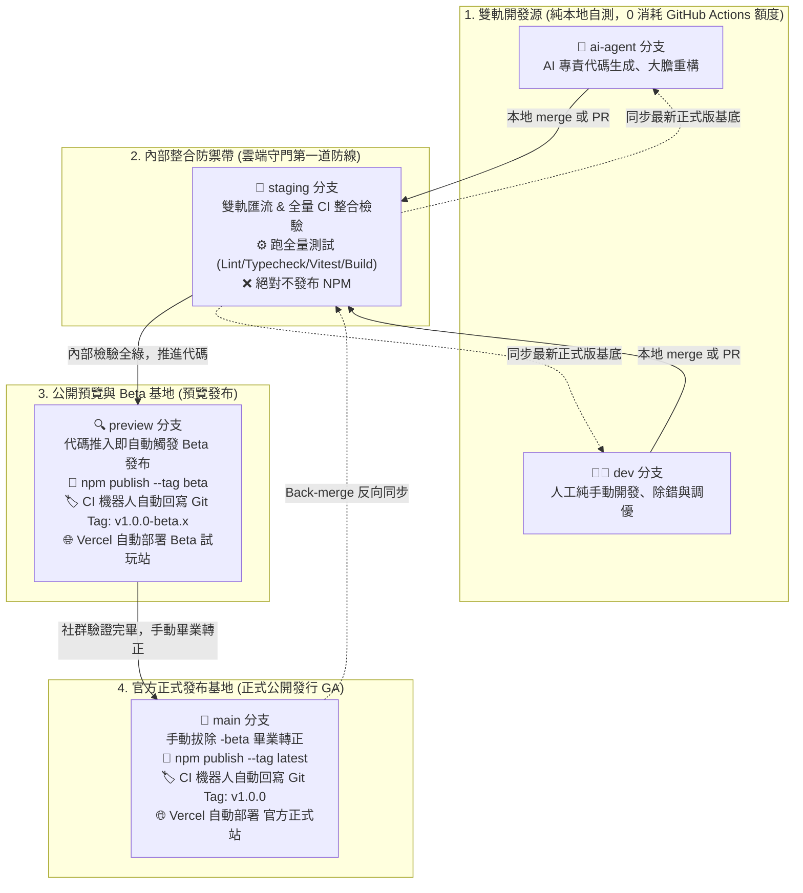

# 🌿 AI Avatar Bot - Git 分支體系與 CI/CD 自動化運作規範手冊
*(Git Branching Pipeline & CI/CD Automation Specification)*

> **文件狀態**：正式規範 (Active Specification)  
> **制定日期**：2026-11-06  
> **適用範圍**：`ai-avatar-bot` 整個 Monorepo 專案，特別指導 `@ai-avatar-bot/sdk` 的日常開發、版本號推進、雙軌匯流與雲端自動化發布。  
> **術語備忘**：文件中的 **GA** 代表軟體工程專有名詞 **General Availability（正式公開發布版 / 穩定生產版）**，非 Google Analytics。

---

## 📑 目錄

- [一、 架構全貌與流動圖 (Architecture Overview)](#一-架構全貌與流動圖-architecture-overview)
- [二、 五階分支定義與職責詳解 (Branch Responsibilities)](#二-五階分支定義與職責詳解-branch-responsibilities)
- [三、 CI/CD 觸發矩陣與額度精算規範 (CI/CD Execution Matrix)](#三-cicd-觸發矩陣與額度精算規範-cicd-execution-matrix)
- [四、 跨平台版本號本地防呆體系 (Pre-push Version Guard)](#四-跨平台版本號本地防呆體系-pre-push-version-guard)
- [五、 日常操作標準作業流程 (Standard Operating Procedures)](#五-日常操作標準作業流程-standard-operating-procedures)
  - [SOP 1：日常雙軌開發與 Staging 匯流](#sop-1日常雙軌開發與-staging-匯流)
  - [SOP 2：推進至 Preview 發布 Beta 預覽版](#sop-2推進至-preview-發布-beta-預覽版)
  - [SOP 3：畢業轉正至 Main 發布正式版 (GA)](#sop-3畢業轉正至-main-發布正式版-ga)
  - [SOP 4：基底反向同步 (Back-merge，關鍵！)](#sop-4基底反向同步-back-merge關鍵)
- [六、 本地直推 (CLI) 與 GitHub PR 雙相容指引](#六-本地直推-cli-與-github-pr-雙相容指引)
- [七、 關聯檔案與組態對照索引 (Configuration Index)](#七-關聯檔案與組態對照索引-configuration-index)

---

## 一、 架構全貌與流動圖 (Architecture Overview)

專案採用兼顧「AI/人工雙軌開發」、「CI 免費額度精算」、「NPM 自動發布」與「Vercel 在線 Demo 部署」的五階流動模型：



---

## 二、 五階分支定義與職責詳解 (Branch Responsibilities)

| 分支名稱 | 角色定位 | 活動者 | 允許推碼方式 | CI 行為 | CD 發布行為 |
| :--- | :--- | :---: | :--- | :--- | :--- |
| **`ai-agent`** | **AI 探索與重構源** | 🤖 AI Assistant | 本地 commit、push 或 PR | **❌ 不跑遠端 CI**<br>(依賴本地 `yarn test:ts` 自測) | ❌ 無 CD |
| **`dev`** | **人工手動開發源** | 🧑‍💻 人類開發者 | 本地 commit、push 或 PR | **❌ 不跑遠端 CI**<br>(依賴本地 `yarn test:ts` 自測) | ❌ 無 CD |
| **`staging`** | **雙軌匯流與內部整合** | 整合審查 | `git merge` 後 push 或 PR | **⚙️ 跑全量嚴格 CI**<br>(Lint, Typecheck, 688 個單元測試, Build) | ❌ **不發布 NPM**<br>(純內部把關) |
| **`preview`** | **公開預覽與 Beta 基地** | 準備對外測試代碼 | `git merge` 後 push 或 PR | **⚙️ 跑全量 CI + 版本防呆** | **🚀 發布 NPM `@beta`**<br>🏷️ 自動補 `v*-beta.*` Tag<br>🌐 Vercel Beta 試玩站 |
| **`main`** | **官方正式發布基地** | 穩定定稿代碼 | `git merge` 後 push 或 PR | **⚙️ 跑全量 CI + 正式防呆** | **🚀 發布 NPM `@latest`**<br>🏷️ 自動補 `v*` Tag<br>🌐 Vercel 官方正式站 |

---

## 三、 CI/CD 觸發矩陣與額度精算規範 (CI/CD Execution Matrix)

### 1. 為什麼徹底排除 `dev` 與 `ai-agent` 的遠端 CI？
* **GitHub Actions 限制**：私有倉庫（Private Repo）每月僅有 **2,000 分鐘** 的免費執行時間。
* **資源精算**：全量跑完 688 個單元測試 + TypeScript 編譯檢查每次約需 **2~3 分鐘**。若 AI 與人類頻繁提交（例如一天 20 次 Commit），2 週內就會耗盡全月額度。
* **解決方案**：
  * 在 `dev` 與 `ai-agent` 頻繁推代碼，消耗 Actions 分鐘數為 **0 分鐘**。
  * 雲端 CI 守門員只設置在 **`staging`**、**`preview`**、**`main`**。只要未通過測試的代碼，在進 `staging` 時必定會被抓包攔截，安全性完全不受影響。

### 2. Monorepo 路徑智慧過濾（Path-based Filtering）
為避免修改某一前端框架時誤觸其他套件的發布，配置專屬路徑監聽：
* **SDK 發布監聽路徑**：`package/typescript/**`（只有此目錄變更才觸發 `@ai-avatar-bot/sdk` 發布）。
* **Vercel Demo 智慧忽略 (Ignored Build Step)**：各 Demo 專案獨立綁定 Root Directory，無變更時自動標記為 `Build Ignored`，零浪費部署資源。

---

## 四、 跨平台版本號本地防呆體系 (Pre-push Version Guard)

為防止在終端機操作時「手滑推錯版本號」，專案配置純 Node.js 編寫的跨平台檢查腳本 [`package/scripts/verify-branch-version.mjs`](file:///Users/parkerchen/Desktop/code/ai-avatar-bot/package/scripts/verify-branch-version.mjs)，搭配 Husky 在本地 `pre-push` 階段攔截：

```text
開發者敲擊: git push origin preview / main
           ↓
[Husky pre-push] 觸發: node scripts/verify-branch-version.mjs
           ↓
  ├── 目標為 preview ➔ 檢查 package.json 是否包含 -beta.x
  │     ├── ❌ 無 -beta (手滑寫成正式版) ➔ 毫秒級攔截 Push，終端機顯示紅字警告
  │     └── ✅ 包含 -beta ➔ 放行 Push
  │
  └── 目標為 main ➔ 檢查 package.json 是否為純數字正式版
        ├── ❌ 含有 -beta 或版本 <= 當前最新正式 Git Tag ➔ 毫秒級攔截 Push
        └── ✅ 無 -beta 且版本嚴格遞增 ➔ 放行 Push
```

> [!TIP]
> **跨平台抹平保證**：
> * 腳本由純 Node.js（`fs`, `semver`, `child_process`）撰寫，抹平了 **Mac (Zsh)** 與 **Windows (PowerShell, CMD, Git Bash)** 的路徑斜線與換行符號（CRLF/LF）差異，兩端無差別流暢執行。
> * **遠端雙保險**：GitHub Actions CI 也會同步執行此檢查，防止使用 `--no-verify` 跳過檢查的情境。

---

## 五、 日常操作標準作業流程 (Standard Operating Procedures)

### SOP 1：日常雙軌開發與 Staging 匯流
```bash
# 情境 A：AI 在 ai-agent 分支完成一項重構，要整合進 staging
git checkout staging
git merge ai-agent
git push origin staging      # 👈 推送後：觸發雲端 CI 跑全量測試，不發布 NPM

# 情境 B：人工在 dev 分支完成開發，要整合進 staging
git checkout staging
git merge dev
git push origin staging
```

---

### SOP 2：推進至 Preview 發布 Beta 預覽版
```bash
# 1. 切換至 preview 分支並合併 staging
git checkout preview
git merge staging

# 2. 提升版本號為 Beta 格式（例如 1.0.0-beta.1）
cd package/typescript
npm version 1.0.0-beta.1 --no-git-tag-version
cd ../..
git commit -am "chore(release): bump version to 1.0.0-beta.1"

# 3. 推送至遠端 (觸發自動防呆檢查 ➔ 通過後自動發布 NPM @beta 與 Vercel Beta 試玩站)
git push origin preview
```

---

### SOP 3：畢業轉正至 Main 發布正式版 (General Availability, GA)
> [!IMPORTANT]
> **正式公開版 (GA) 畢業時必須「手動移除 -beta 後綴」**，依循以下 4 步標準清單：

```bash
# 1. 切換至 main 分支並合併 preview
git checkout main
git merge preview

# 2. 手動拔除 -beta 後綴（正式升版）
cd package/typescript
npm version 1.0.0 --no-git-tag-version
cd ../..

# 3. 提交 Commit 並推送
git commit -am "chore(release): 1.0.0 official GA release"
git push origin main
# 👈 推送後：CI 通過 ➔ 自動發布 @ai-avatar-bot/sdk@1.0.0 (latest) ➔ 機器人自動補齊 v1.0.0 Tag ➔ 部署官方正式站
```

---

### SOP 4：基底反向同步 (Back-merge，關鍵！)
> [!CAUTION]
> 正式版發布後，**絕對不能遺漏反向同步**，否則 `staging`、`dev` 與 `ai-agent` 會遺失正式版的發布紀錄，造成後續開發基底漂移！

```bash
# 1. 將 main 反向合併回 staging
git checkout staging
git merge main
git push origin staging

# 2. 同步最新基底至人工開發分支 dev
git checkout dev
git merge staging
git push origin dev

# 3. 同步最新基底至 AI 開發分支 ai-agent
git checkout ai-agent
git merge staging
git push origin ai-agent

# 4. (可選) 隨後可將 dev 版號更新為 1.1.0-beta.0 開啟下一輪功能衝刺
```

---

## 六、 本地直推 (CLI) 與 GitHub PR 雙相容指引

本體系對 **「個人終端機開發」** 與 **「團隊 PR 審查」** 具備 100% 等價相容性：

* **習慣終端機極速流（個人作業）**：
  直接使用上述 SOP 中的 `git merge` + `git push origin <branch>`，指令敲完即走，雲端 Actions 自動接手。
* **習慣 GitHub 網頁 PR 流（團隊協作）**：
  在 GitHub 發起 Pull Request（如 `staging ➔ preview`），在網頁點擊「Merge pull request」，觸發的 CI/CD 效果完全相同。

---

## 七、 關聯檔案與組態對照索引 (Configuration Index)

| 檔案路徑 | 作用與規格說明 |
| :--- | :--- |
| [`package/scripts/verify-branch-version.mjs`](file:///Users/parkerchen/Desktop/code/ai-avatar-bot/package/scripts/verify-branch-version.mjs) | 跨平台版本號防呆驗證腳本（相容 Mac & Windows）。 |
| [`.husky/pre-push`](file:///Users/parkerchen/Desktop/code/ai-avatar-bot/.husky/pre-push) | 本地 Git Hook，於 `git push` 前執行版本號合規檢驗。 |
| [`.github/workflows/ci.yml`](file:///Users/parkerchen/Desktop/code/ai-avatar-bot/.github/workflows/ci.yml) | 遠端 CI 守門員（僅限 `staging`、`preview`、`main`，排除 `dev`/`ai-agent`）。 |
| [`.github/workflows/release-sdk.yml`](file:///Users/parkerchen/Desktop/code/ai-avatar-bot/.github/workflows/release-sdk.yml) | 遠端 CD 自動發布（帶 `package/typescript/**` 路徑過濾，自動發布 NPM 與回寫 Tag）。 |
| [`package/typescript/vite.demo.config.ts`](file:///Users/parkerchen/Desktop/code/ai-avatar-bot/package/typescript/vite.demo.config.ts) | Vercel 在線展示站專屬 SPA 打包配置（輸出至 `dist-demo/`）。 |
| [`package/typescript/docs/NPM_AND_DEMO_RELEASE_PLAN.md`](file:///Users/parkerchen/Desktop/code/ai-avatar-bot/package/typescript/docs/NPM_AND_DEMO_RELEASE_PLAN.md) | 新 Session 實施專用分步驟手冊（7 大具體執行步驟）。 |

