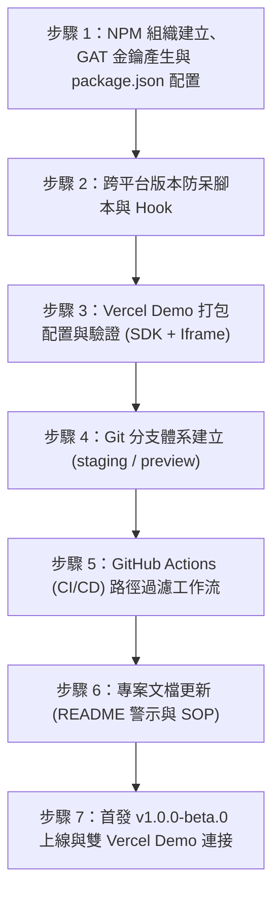

# 🚀 AI Avatar Bot 發布與部署分步驟實施手冊
*(Step-by-Step Implementation Guide for New Session)*

> **文件狀態**：執行上線中 (In Execution - v2.1 已對齊實際 Git 倉庫根目錄路徑)  
> **制定日期**：2026-11-05 (2026-11-06 增補術語備忘)  
> **適用場景**：專門為**開立新 Session 進行純淨實作**所設計之自包含（Self-contained）執行指南。新 Session 中的 AI 助理可直接依序執行以下 7 個具體步驟，無需重構或重新討論決策。  
> **路徑備註**：遠端 GitHub 倉庫（`archer102125220/ai-avatar-bot`）之根目錄對應本地工作區之 `package/`，故 GitHub Actions 路徑過濾為 `typescript/**`，Vercel 之 `Root Directory` 分別為 `typescript` 與 `iframe`。  
> **術語備忘**：文件中的 **GA** 代表軟體工程專有名詞 **General Availability（正式公開發布版 / 穩定生產版）**，非 Google Analytics。

---

## 🧭 前情提要與已定案決策摘要 (Executive Summary)

本指南已彙整先前討論之所有技術與架構決策：
1. **套件正名與 NPM 發布矩陣**：
   * 原生 TypeScript 旗艦套件：**`@ai-avatar-bot/sdk`**（發布至 NPM，含完整 UI Widget、雙渲染、語音與推論引擎）。
   * 框架封裝（未來）：`@ai-avatar-bot/vue`、`@ai-avatar-bot/react`（發布至 NPM）。
   * 經典版 `package/iframe`：**❌ 不發布 NPM 套件，不跑 CI/CD，純作為歷史/經典 Demo 部署**。
2. **NPM 最新資安認證規格（2025/2026 最新標準）**：
   * NPM 官方已淘汰舊版 Classic / Automation Token。
   * 首發採 **Granular Access Token (GAT)**：期限 90 天，僅限 `@ai-avatar-bot` 組織範圍，權限設定為 Read and write。
   * 未來演進：首發上線後，可切換為 **Trusted Publishing (OIDC 免密鑰發布)**，免除維護 Token 與過期問題。
3. **Monorepo 路徑智慧過濾（Path Filtering）**：
   * GitHub Actions 具備路徑過濾：只有 `package/typescript` 有改動時才發布 SDK，其餘套件不受干擾。
   * Vercel 具備 Ignored Build Step：只有各自資料夾有改動時才啟動該專案的 Demo 構建。
4. **五階分支體系（方案 B - 組合 2）**：
   * `dev`：純手動人工開發（不跑遠端 CI）。
   * `ai-agent`：AI 專責代碼生成與重構（不跑遠端 CI）。
   * `staging`：雙軌匯流整合檢查（**全量 CI 集中守門，不發布 NPM**）。
   * `preview`：公開 Beta 預覽基地（**CI 通過 ➔ 自動發布 NPM `@beta` + Vercel Beta 試玩站**）。
   * `main`：官方正式發布基地（**Release PR 畢業轉正 ➔ 自動發布 NPM `@latest` + Vercel 官網**）。
5. **CI 額度精算**：
   * 排除 `dev` 與 `ai-agent` 的遠端 CI 觸發，改由本地自測，節省 90% 以上 GitHub Actions 免費額度。
6. **跨平台版本號防呆（Mac & Windows）**：
   * 本地透過純 Node.js 跨平台腳本搭配 Husky `pre-push` Hook 攔截。
   * 推送至 `preview` 必須含 `-beta.`；推送至 `main` 必須拔除 `-beta` 且版號遞增。
7. **手動畢業與反向同步（Back-merge）**：
   * 從 Beta 晉升正式版時，在 `preview ➔ main` 執行 `npm version 1.0.0 --no-git-tag-version` 拔除後綴。
   * 發布後必須執行反向同步：`main ➔ staging ➔ dev & ai-agent`。
8. **Vercel 多專案 Demo 矩陣**：
   * 原生 TS SDK 展示：`ai-avatar-bot-sdk-demo.vercel.app`
   * 經典 Iframe 展示：`ai-avatar-bot-iframe-demo.vercel.app`（純 Demo 部署）
   * 未來 Vue/React 展示：`ai-avatar-bot-vue-demo`、`ai-avatar-bot-react-demo`

---

## 📦 Monorepo 套件與 Demo 部署對照矩陣

| 目錄路徑 | NPM 套件發布 | GitHub Actions CI/CD | Vercel Demo 專案名稱 | Vercel 網域 (正式 / 預覽) |
| :--- | :---: | :---: | :--- | :--- |
| [`package/typescript`](file:///Users/parkerchen/Desktop/code/ai-avatar-bot/package/typescript) | **`@ai-avatar-bot/sdk`** | ✅ 全量 CI + 自動 CD | `ai-avatar-bot-sdk-demo` | `https://ai-avatar-bot-sdk-demo.vercel.app`<br>`https://beta.ai-avatar-bot-sdk-demo.vercel.app` |
| [`package/iframe`](file:///Users/parkerchen/Desktop/code/ai-avatar-bot/package/iframe) | ❌ **不發布** | ❌ **不跑 CI/CD** | `ai-avatar-bot-iframe-demo` | `https://ai-avatar-bot-iframe-demo.vercel.app`<br>*(純做歷史經典 Demo 部署，展示一行腳本嵌入)* |
| [`package/vue`](file:///Users/parkerchen/Desktop/code/ai-avatar-bot/package/vue) | **`@ai-avatar-bot/vue`** | 🚧 進行中 | `ai-avatar-bot-vue-demo` | `https://ai-avatar-bot-vue-demo.vercel.app` |
| [`package/react`](file:///Users/parkerchen/Desktop/code/ai-avatar-bot/package/react) | **`@ai-avatar-bot/react`** | 🚧 進行中 | `ai-avatar-bot-react-demo` | `https://ai-avatar-bot-react-demo.vercel.app` |

---

## 📋 七大分步驟實施清單 (Step-by-Step Roadmap)



---

### 步驟 1：NPM 組織建立、GAT 金鑰產生與 `package.json` 配置
* **目標**：完成 NPM 組織準備、取得發布授權金鑰，並調整 `package/typescript` 配置。
* **執行任務**：
  1. **人工前置動作 A（NPM 組織建立）**：
     * 前往 [npmjs.com](https://www.npmjs.com) 註冊免費組織 `ai-avatar-bot`。
  2. **人工前置動作 B（產生 Granular Access Token）**：
     * 點擊頭像 ➔ **Access Tokens** ➔ **Generate New Token** ➔ 選擇 **Granular Access Token**。
     * Token Name：輸入 `github-actions-release`。
     * Expiration：選擇 **90 days**。
     * Packages and scopes：選擇 **Only select packages and scopes** ➔ 勾選 `@ai-avatar-bot` 組織。
     * Permissions：選擇 **Read and write**。
     * 複製產生的 `npm_...` 金鑰。
  3. **人工前置動作 C（配置 GitHub Repo Secret）**：
     * 開啟 GitHub Repo ➔ **Settings** ➔ **Secrets and variables** ➔ **Actions**。
     * 新增 Secret：名稱為 **`NPM_TOKEN`**，內容貼上剛才複製的金鑰。
  4. **專案程式碼配置**：
     * 修改 `package/typescript/package.json`：
       * `"name": "@ai-avatar-bot/sdk"`
       * `"version": "1.0.0-beta.0"`
       * 新增 `"publishConfig": { "access": "public", "tag": "beta" }`
     * 驗證依賴引用：檢查 `package/typescript/README.md` 及範例專案中是否有寫死的舊名稱需同步更新。

---

### 步驟 2：跨平台版本防呆腳本與 Husky pre-push 配置
* **目標**：在本地攔截手滑推錯版本號，抹平 Mac 與 Windows 作業系統差異。
* **執行任務**：
  1. 建立純 Node.js 跨平台驗證腳本：`package/scripts/verify-branch-version.mjs`。
     * 規則 A：若目標為 `preview` 分支，讀取 `package/typescript/package.json`，若版本號不含 `-beta.` 則中斷退出（`process.exit(1)`）並顯示紅字警告。
     * 規則 B：若目標為 `main` 分支，若版本號含 `-beta` 或小於等於目前最新 Git Tag 則中斷退出。
  2. 安裝與設定 Husky `pre-push` Hook：
     * 指向 `node scripts/verify-branch-version.mjs`。
  3. 本地測試：刻意用不合規版本號測試 `git push --dry-run`，確認攔截行為正常。

---

### 步驟 3：Vercel Demo 打包配置與驗證（SDK + Iframe）
* **目標**：配置 SDK 與 Iframe 之在線 Demo 打包機制。
* **執行任務**：
  1. **SDK 部分**：
     * 建立 `package/typescript/vite.demo.config.ts`（以 `index.html` 為 SPA 入口，輸出至 `dist-demo/`）。
     * 在 `package/typescript/package.json` 新增 `"build:demo": "vite build --config vite.demo.config.ts"`。
     * 本地驗證 `yarn workspace @ai-avatar-bot/sdk build:demo` 產物正常。
  2. **Iframe 經典版部分**：
     * 檢閱 [`package/iframe/vercel.json`](file:///Users/parkerchen/Desktop/code/ai-avatar-bot/package/iframe/vercel.json)（已內建 static html 與 serverless tts 配置）。
     * 確認其作為純 Demo 靜態網站可隨時由 Vercel 直接部署，不需進行 NPM 打包。

---

### 步驟 4：Git 分支體系建立與基底對齊
* **目標**：建立五階管線所需之基底分支。
* **執行任務**：
  1. 以當前穩定代碼為基底，建立並推送 `staging` 分支：
     ```bash
     git checkout -b staging
     git push -u origin staging
     ```
  2. 以 `staging` 為基底建立並推送 `preview` 分支：
     ```bash
     git checkout -b preview
     git push -u origin preview
     ```
  3. 確認分支樹狀態：`main`、`staging`、`preview`、`dev`、`ai-agent` 均已就位。

---

### 步驟 5：GitHub Actions (CI/CD) 雙工作流建立（附帶路徑智慧過濾）
* **目標**：建立雲端全自動化守門與精確發布管線。
* **執行任務**：
  1. 建立根目錄 `.github/workflows/ci.yml`：
     * 監聽條件：**僅限** `staging`、`preview`、`main` 的 Push 與 PR（排除 `dev` 與 `ai-agent` 節省額度）。
     * 任務：版本防呆檢查 (`verify-branch-version.mjs`) ➔ Lint ➔ Typecheck ➔ Vitest (688 測試) ➔ Build。
  2. 建立根目錄 `.github/workflows/release-sdk.yml`：
     * 監聽條件：Push 至 `preview` 或 `main`，且 **`paths: ['package/typescript/**']`**（只有 TS 目錄有動才觸發！）。
     * 任務：
       * 若為 `preview`：執行 `npm publish --tag beta --access public`（讀取 `secrets.NPM_TOKEN`）。
       * 若為 `main`：執行 `npm publish --tag latest --access public`。
       * 自動使用 `github-actions[bot]` 回寫對應 Git Tag（如 `v1.0.0-beta.0`）並建立 GitHub Release。

---

### 步驟 6：專案文檔更新 (README 警示與 SOP 註記)
* **目標**：補齊社群預覽版警示公告與團隊五階分支 SOP 規範。
* **執行任務**：
  1. 更新 `package/typescript/README.md` 與 `package/typescript/README_ZH.md`：
     * 頂部加入 Alert 標記：目前處於公開 Beta 階段，正在進行大腦領域中立化解耦。
  2. 在根目錄 `package/README.md` 或新設 `CONTRIBUTING.md`：
     * 關聯參考專屬手冊：[`package/typescript/docs/BRANCHING_AND_CICD_WORKFLOW.md`](file:///Users/parkerchen/Desktop/code/ai-avatar-bot/package/typescript/docs/BRANCHING_AND_CICD_WORKFLOW.md)
     * 記錄五階分支管線規範。
     * 記錄各套件與 Demo 矩陣（含 Iframe 純 Demo 說明）。
     * 記錄畢業手動拔除 `-beta` 的 4 步 SOP 與 Back-merge 規範。

---

### 步驟 7：首發 `v1.0.0-beta.0` 上線與雙 Vercel Demo 連接
* **目標**：完成首個預覽版正式上架與在線展示站運作。
* **執行任務**：
  1. 在 Vercel 控制台新增 **SDK Demo 專案**：
     * **Project Name**：設為 **`ai-avatar-bot-sdk-demo`**。
     * **Root Directory**：設為 `typescript`（對應遠端倉庫根目錄下之 `typescript/`）。
     * **Build Command**：設為 `yarn build:demo`。
     * **Output Directory**：設為 `dist-demo`。
     * **Ignored Build Step**（選配）：`git diff --quiet HEAD^ HEAD ./`
     * 域名對應：正式 `https://ai-avatar-bot-sdk-demo.vercel.app`，預覽 `https://beta.ai-avatar-bot-sdk-demo.vercel.app`。
  2. 在 Vercel 控制台新增 **Iframe 經典版 Demo 專案**：
     * **Project Name**：設為 **`ai-avatar-bot-iframe-demo`**。
     * **Root Directory**：設為 `iframe`（對應遠端倉庫根目錄下之 `iframe/`）。
     * **Ignored Build Step**（選配）：`git diff --quiet HEAD^ HEAD ./`
     * 域名對應：`https://ai-avatar-bot-iframe-demo.vercel.app`。
  3. 推送最新代碼至 `preview` 分支，觀察 GitHub Actions 自動執行發布。
  4. 驗證 NPM 上已成功上架 `@ai-avatar-bot/sdk@1.0.0-beta.0`。
  5. 驗證兩大 Vercel Demo 網址皆可正常在線互動。
  6. *(可選未來演進)*：首發成功後，可前往 NPM 套件頁面配置 Trusted Publishing (OIDC)，之後可將 GitHub 上的 `NPM_TOKEN` 移除，邁向完全無密鑰發布。

---

## 🎯 新 Session 啟動 Prompt 建議

在新 Session 開始時，請直接複製以下 Prompt 傳給 AI 助理即可無縫銜接：

```text
請閱讀 package/typescript/docs/NPM_AND_DEMO_RELEASE_PLAN.md。
我們已經在前一個 Session 完成所有架構討論與決策（套件正名 @ai-avatar-bot/sdk、Vercel 雙 Demo 連接、五階分支策略、Granular Access Token 配置、路徑智慧過濾、跨平台 pre-push 防呆、CI 額度精算與手動畢業 SOP）。
請不要重新討論架構，直接作為專案工程師，依序從「步驟 1」開始精準執行實作！
```
